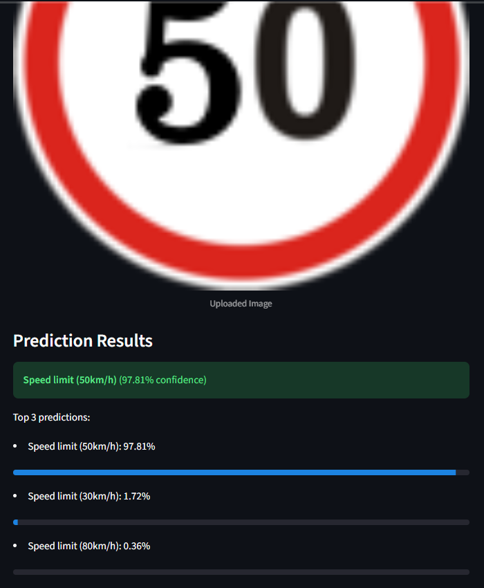
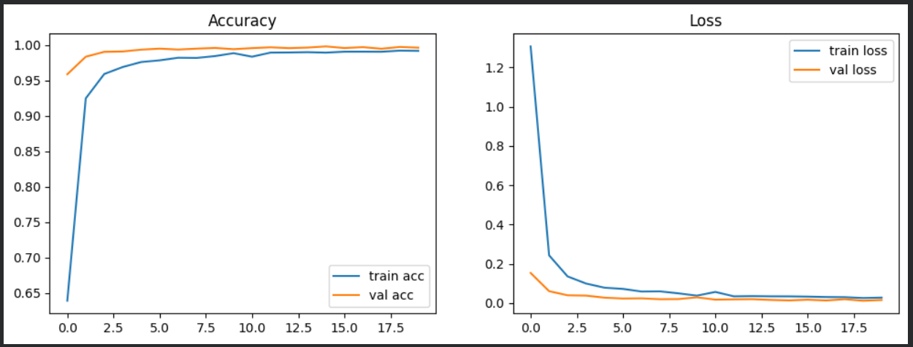

# Traffic Sign Recognition Using Deep Learning

A deep learning lab project that classifies cropped traffic sign images into **43 GTSRB categories** using a convolutional neural network (CNN). A Streamlit app displays the top three predictions and their confidence scores.

## Demo



The supplied example predicts **Speed limit (50 km/h)** with **97.81% confidence**. Confidence for one image differs from overall test accuracy.

## Run locally

Use Python 3.11 or 3.12 and a virtual environment. From the repository directory:

```bash
python -m venv .venv
```

Activate it on Windows PowerShell:

```powershell
.\.venv\Scripts\Activate.ps1
```

Or on macOS / Linux:

```bash
source .venv/bin/activate
```

Install dependencies and launch the app:

```bash
python -m pip install -r requirements.txt
python -m streamlit run app.py
```

Open the local URL printed by Streamlit and upload a JPG, JPEG, PNG or PPM image containing a traffic sign. The saved model is included, so retraining is optional.

## Repository contents

| File | Purpose |
| --- | --- |
| `app.py` | Streamlit image upload and top-three predictions |
| `traffic_sign_model.h5` | Saved TensorFlow/Keras model |
| `Traffic Sign Recognition.ipynb` | Google Colab training and evaluation notebook |
| `requirements.txt` | Dependencies for local inference |
| `requirements-training.txt` | Additional training dependencies |
| `docs/Traffic_Sign_Recognition_Presentation.pptx` | Editable eight-slide lab presentation |
| `docs/images/` | Training, evaluation and app outputs |

## Dataset and preprocessing

Dataset: [German Traffic Sign Recognition Benchmark on Kaggle](https://www.kaggle.com/datasets/meowmeowmeowmeowmeow/gtsrb-german-traffic-sign).

- 39,209 original training images across 43 classes.
- Stratified split into 31,367 training and 7,842 validation images.
- 12,630 separate test images.
- Convert OpenCV BGR images to RGB, resize to 32 × 32 pixels, divide pixels by 255, and one-hot encode labels.

The dataset is deliberately excluded from Git. Download it from its source and follow its terms of use.

## Train in Google Colab

1. Open `Traffic Sign Recognition.ipynb` in Google Colab.
2. Select a GPU runtime if available.
3. Upload the dataset ZIP to the Files tab as `/content/archive.zip`.
4. Run the notebook cells in order. The extraction cell locates the dataset root, including when the ZIP has a wrapper folder.
5. The dataset root must contain `Train/`, `Test/` and `Test.csv`.
6. The last cell saves and downloads `traffic_sign_model.h5`. Replace the local model only if you want to use the new training run.

The ZIP cell checks extraction paths. Wait for the upload to finish before extracting. Runtime files disappear when the Colab runtime is deleted.

For training outside Colab, install `requirements-training.txt` and adapt the `/content/` paths and Colab-specific download cell.

## Model

| Stage | Configuration |
| --- | --- |
| Input | 32 × 32 × 3 RGB image |
| Convolution block 1 | Two 32-filter 5 × 5 ReLU convolutions, 2 × 2 max pooling, 25% dropout |
| Convolution block 2 | Two 64-filter 3 × 3 ReLU convolutions, 2 × 2 max pooling, 25% dropout |
| Classifier | Flatten, Dense(256, ReLU), 50% dropout, Dense(43, Softmax) |

The convolutions use valid padding. The network has **356,939 trainable parameters**. Training uses Adam, categorical crossentropy, a batch size of 64 and 20 epochs.

## Recorded results

The supplied latest evaluation screenshot reports **97.89% test accuracy**, macro F1 **0.97**, and weighted F1 **0.98** on 12,630 test images.

The committed notebook retains an earlier run reporting **97.31% test accuracy**. These are separate recorded runs. The newer screenshot is not a fresh evaluation of the bundled model, and its correspondence to that model has not been independently verified. Results can vary between training runs.



[View the latest full classification report](docs/images/classification-report.png).

## Limitations and possible improvements

The model classifies a supplied sign image. It does not locate signs in a full road scene or track objects in video. It always chooses among its 43 classes, including for unrelated images. Performance varies by class and image conditions.

Possible extensions include data augmentation, a detector for full road scenes, confidence calibration and TensorFlow Lite deployment.

## Acknowledgment and licensing

This project adapts [CMSMalshan/Traffic-Sign-Recognition](https://github.com/CMSMalshan/Traffic-Sign-Recognition). Source attribution is retained here. This repository uses a fresh history for the adapted lab project. This version includes the Colab ZIP workflow, lab presentation and project-specific documentation.

No explicit license file was present in the source checkout. This repository does not assign a new license to the original author's work. Dataset terms are separate from code licensing.
